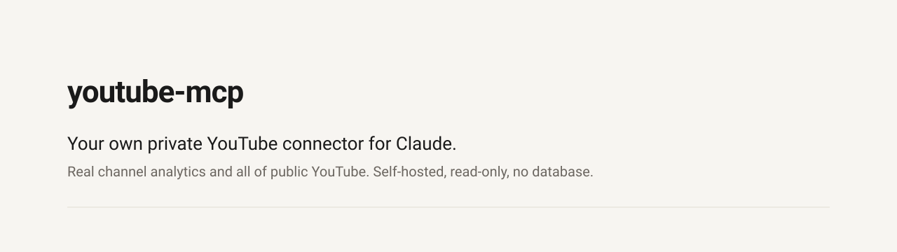
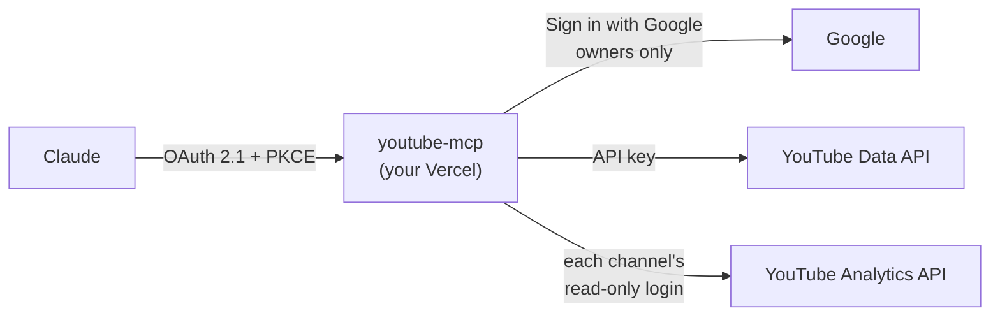
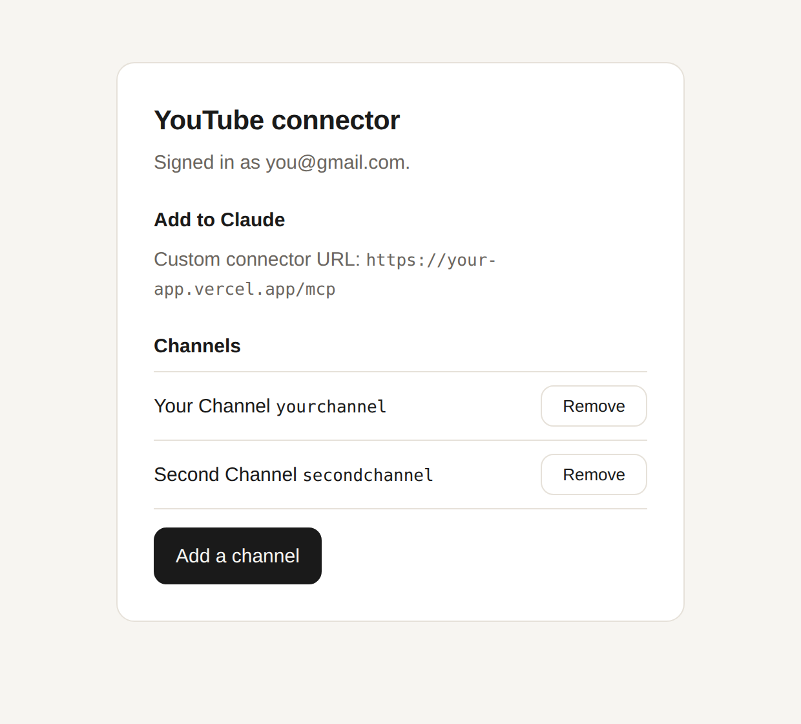
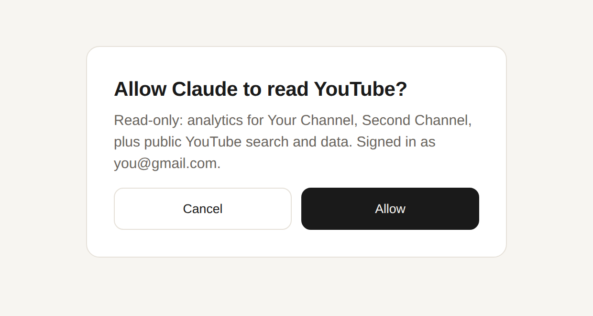

<picture>
  <source media="(prefers-color-scheme: dark)" srcset="docs/banner-dark.svg">
  
</picture>

Claude gets your channels' real analytics (retention, traffic sources, the searches that found you, audience) and all
of public YouTube (search, any video or channel, comments). It can research the way you would with YouTube Studio
and a search tab open, on claude.ai, the desktop and phone apps, and Claude Code.

It runs on your own Vercel account with your own Google Cloud project. Only the Google accounts you list can use it.

[](https://vercel.com/new/clone?repository-url=https%3A%2F%2Fgithub.com%2FNikhilDhaliya%2Fyoutube-mcp&env=CONNECTOR_KEY,GOOGLE_CLIENT_ID,GOOGLE_CLIENT_SECRET,YOUTUBE_API_KEY,OWNER_EMAILS&envDescription=See%20the%20setup%20steps%20in%20the%20README&envLink=https%3A%2F%2Fgithub.com%2FNikhilDhaliya%2Fyoutube-mcp%23setup&project-name=youtube-mcp&repository-name=youtube-mcp)

## Ask it things like

> How did my last three videos do in their first week, and where did the views come from?

> Find what broke out this week in budget AI hardware, and what the top comments keep asking for.

> My retention drops at 0:40 on the last video. Compare it with my best one and tell me what's different.

## Why this one

|  |  |
|---|---|
| **Private** | Your server, your Google project, your keys. Nothing sits in the middle, and only your listed accounts can connect. |
| **Remote** | A real connector with sign-in, so it works in the Claude apps and on your phone, not only on one computer. |
| **Free** | Vercel's free plan and YouTube's free quota (10,000 units a day) cover one person easily. |
| **No database** | Tokens and your channel list are encrypted with your key and carry their own expiry. |
| **Read-only** | It asks Google for read scopes only. It can't upload, edit or delete anything. |

## Tools

| Tool | What it does |
|---|---|
| `my_channels` | Your connected channels and their public totals |
| `youtube_analytics` | Any YouTube Analytics report for your channels: views, watch time, retention curves, traffic sources, search terms, audience, revenue |
| `youtube_data` | Any read call of the YouTube Data API: search, videos, channels, playlists, comments, trending charts |
| `find_breakouts` | Several searches at once, ranked by views per subscriber, to spot videos that outgrew their channel |

## How it works



The app is both a small OAuth server and an MCP server. Claude signs in through it; you approve with your Google
account. Your channels are added once from a setup page.

<p align="center">
  
  &nbsp;
  
</p>

## Setup

About 15 minutes. You need a Google account, a Vercel account and Claude.

### 1. Google Cloud

1. In [console.cloud.google.com](https://console.cloud.google.com), create a project.
2. **APIs & Services → Library**: enable **YouTube Data API v3** and **YouTube Analytics API**.
3. **APIs & Services → Credentials → Create credentials → API key**, restricted to the YouTube Data API v3. This is
   `YOUTUBE_API_KEY`.
4. **Google Auth Platform → Branding**: an app name, your email, a homepage URL and a privacy policy URL. Google asks
   for both URLs before it lets you publish.
5. **Audience**: External, then **Publish app**. While an app is in "Testing", Google expires its logins after 7 days.
6. **Clients → Create client → Web application**, with the redirect URI `https://<your-domain>/auth/google/callback`
   (you get the domain in the next step and can edit this later). Add `http://localhost:3000/auth/google/callback`
   too if you'll run it locally. The client ID and secret are `GOOGLE_CLIENT_ID` and `GOOGLE_CLIENT_SECRET`.

### 2. Deploy

Click **Deploy with Vercel** above and fill in:

| Variable | Value |
|---|---|
| `CONNECTOR_KEY` | `openssl rand -base64 32` |
| `GOOGLE_CLIENT_ID`, `GOOGLE_CLIENT_SECRET` | From step 1.6 |
| `YOUTUBE_API_KEY` | From step 1.3 |
| `OWNER_EMAILS` | The Google account(s) allowed to use it, comma-separated |

Then add your Vercel domain to the Google client's redirect URIs (step 1.6).

### 3. Add your channels

1. Open `https://<your-domain>/setup` and sign in with an owner account.
2. Click **Add a channel** and pick the Google account (or Brand Account) that owns the channel. Google warns that
   the app isn't verified: it's your own app, so choose **Advanced → Go to (your app)**.
3. Copy the value it shows into a Vercel environment variable named `YOUTUBE_CHANNELS`, then redeploy.

Repeat for each channel. The value is encrypted with your `CONNECTOR_KEY`.

> [!TIP]
> If Google shows **Error 400: invalid_request** for a channel's account, add that account to your Google Cloud
> project (**IAM & Admin → Grant access**, role Editor), then try again.

### 4. Connect Claude

**Settings → Connectors → Add custom connector**, with the URL `https://<your-domain>/mcp`. On a Team or Enterprise
plan, an owner adds it under **Organization settings → Connectors** first. Click **Connect**, sign in with your owner
Google account and click **Allow**.

## Security

- Google scopes are read-only: `youtube.readonly`, `yt-analytics.readonly`, `yt-analytics-monetary.readonly`.
- Only accounts in `OWNER_EMAILS` can sign in, add channels or allow a client.
- Clients use OAuth 2.1 with PKCE. Access tokens last 1 hour and refresh tokens 90 days, all sealed with AES-256-GCM
  using `CONNECTOR_KEY`.
- To sign every client out, change `CONNECTOR_KEY` and redeploy, then add your channels again. To cut off one
  channel, remove it in `/setup` and remove the app at
  [myaccount.google.com/permissions](https://myaccount.google.com/permissions).

## Limits

- Impressions and click-through rate aren't in YouTube's API, only in Studio.
- Other channels' transcripts aren't in the official API.
- 10,000 quota units a day per Google project. A search costs 100; most other reads cost 1.

## Run locally

```bash
cp .env.example .env.local   # fill it in
pnpm install
pnpm dev                     # http://localhost:3000
```

## Make your own connector

Nothing in the OAuth server (`src/lib/oauth`, `src/app/oauth`, `src/app/api/oauth`, `src/app/.well-known`) or the
MCP route (`src/app/mcp`) knows about YouTube. Replace `src/lib/tools.ts` with your own tools and you have a private
connector for anything.

## License

MIT. Not affiliated with YouTube, Google or Anthropic.
